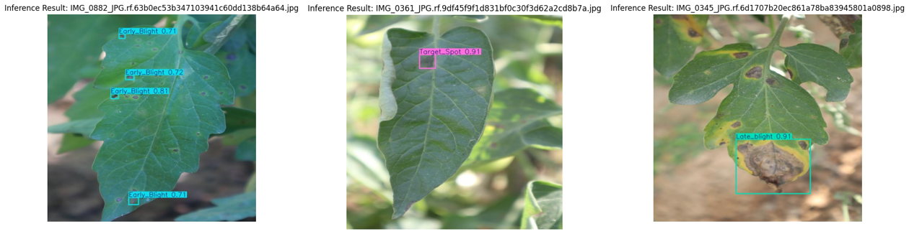
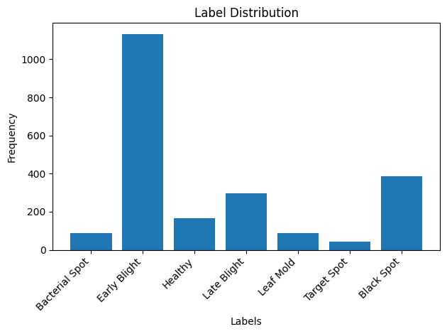

# Tomato Leaf Disease Detection with YOLOv8

Detects and localises **7 tomato leaf conditions** in photos (6 diseases plus healthy leaves) using a YOLOv8
object detector, with a Gradio web demo for uploading a leaf photo and seeing the detections.
Final-year B.Tech project (AI & Data Science).

<p align="center"></p>

## Problem

Tomato diseases such as early blight and late blight spread fast, and spotting them early by eye takes an
expert. The goal is a lightweight model that marks diseased regions on a leaf photo, so farmers and
agronomists can act sooner.

## Dataset

[Tomato Leaf Diseases Detect v3](https://universe.roboflow.com/sylhet-agricultural-university/tomato-leaf-diseases-detect/dataset/3)
(Roboflow Universe, public domain), with bounding-box labels in YOLO format.

- **737 images**, resized to 640×640, split into train / valid / test (61 validation images, 31 test images)
- **7 classes:** Bacterial Spot, Early Blight, Healthy, Late Blight, Leaf Mold, Target Spot, Black Spot
- **Strongly imbalanced:** Early Blight has 1,134 labelled instances in the training set, while Target Spot has 42

<p align="center"></p>

## Approach

1. Inspected images and drew the ground-truth boxes to sanity-check the labels; found 18 empty label files
2. Counted instances per class to measure the imbalance
3. Fine-tuned **YOLOv8n** (3M parameters, COCO-pretrained) for 75 epochs at 240 px, batch size 32, on a Tesla T4
4. Evaluated on the validation split, ran inference on the held-out test images (confidence ≥ 0.7)
5. Wrapped the best checkpoint in a **Gradio** app for interactive predictions

## Results (validation set)

| Class | Images | Instances | Precision | Recall | mAP@50 |
|---|---:|---:|---:|---:|---:|
| **All classes** | 61 | 196 | 0.65 | 0.57 | **0.59** |
| Healthy | 19 | 19 | 0.93 | 1.00 | **0.99** |
| Late Blight | 13 | 29 | 0.81 | 0.86 | **0.90** |
| Early Blight | 31 | 96 | 0.71 | 0.68 | 0.71 |
| Bacterial Spot | 3 | 4 | 0.72 | 0.50 | 0.55 |
| Target Spot | 5 | 6 | 0.50 | 0.50 | 0.51 |
| Black Spot | 21 | 35 | 0.65 | 0.14 | 0.26 |
| Leaf Mold | 4 | 7 | 0.24 | 0.29 | 0.21 |

Inference takes about 6 ms per image on a T4 GPU.

**What the numbers say:** the model separates healthy leaves almost perfectly (mAP@50 0.99) and detects
late blight well (0.90). It struggles with rare classes that have only a handful of validation examples
(Leaf Mold, Target Spot), and with Black Spot. Black Spot has many examples, but its recall is very low:
the spots are small, and the 240 px training size loses detail.

## Ideas to improve

- Train at a higher resolution (640 px) to catch small lesions like Black Spot
- Rebalance with class-weighted sampling or targeted augmentation for rare classes
- Try a larger model (YOLOv8s/m) and more epochs with early stopping
- Collect more images for Leaf Mold, Target Spot and Bacterial Spot

## Run it

The notebook was built on Google Colab with a GPU.

1. Open `tomato_leaf_disease_yolov8.ipynb` in Colab (Runtime → Change runtime type → GPU)
2. Download the dataset from the Roboflow link above in **YOLOv8** format, upload the zip to Colab as
   `cap 2.zip` (or change the unzip cell to match your file name), and set the paths in `data.yaml` to
   `/content/train/images`, `/content/valid/images` and `/content/test/images`
3. Run all cells. The last cell launches the Gradio demo.

```bash
# training command used
yolo detect train model=yolov8n.pt data=data.yaml epochs=75 imgsz=240 batch=32
```

**Tech:** Python · Ultralytics YOLOv8 · PyTorch · OpenCV · pandas · Matplotlib · Gradio

## Author

**Deepack Sudhakar**: AI Engineer, Dubai · [LinkedIn](https://linkedin.com/in/deepack-s-a5069324b) · [GitHub](https://github.com/Deepack-1)
